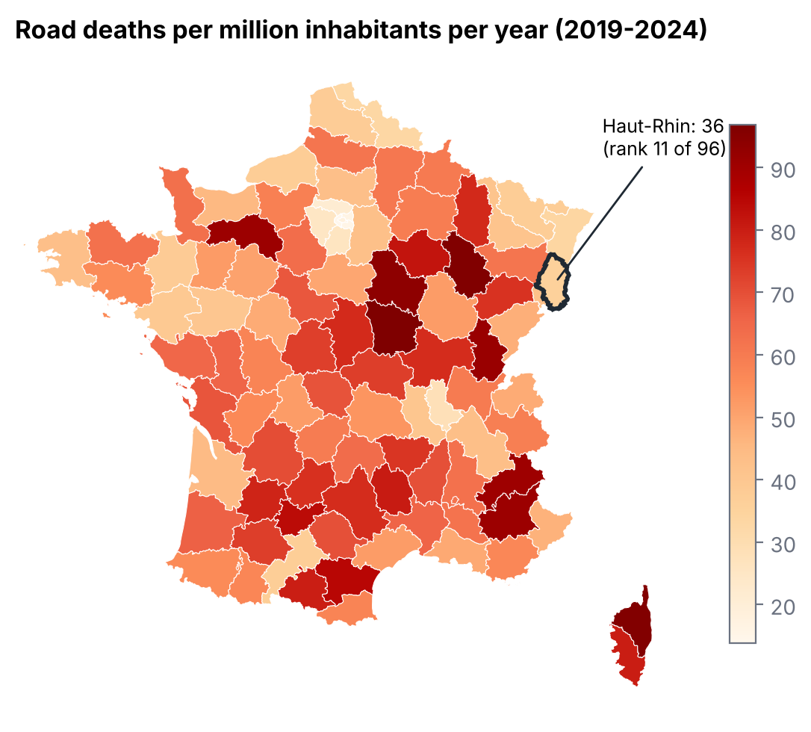

# Road accidents in France and in Haut-Rhin, 2019–2024

An end-to-end data analysis of **309,756 injury accidents** and **18,356 road deaths** recorded by the
police in metropolitan France between 2019 and 2024, with a focus on Haut-Rhin (Mulhouse, Colmar).

**Read the [report (PDF)](report/report.pdf)** · browse the [notebook](notebooks/road_accidents.ipynb) · SQL in [`sql/`](sql/)



## Key findings

| | |
|---|---|
| **Flat since 2019** | About 3,000 deaths a year; accidents never returned to their 2019 level, deaths did. |
| **Outside towns** | 36% of accidents but **68% of deaths** happen outside built-up areas. |
| **Night** | Between 3 and 6 a.m., about 11% of accidents are fatal, vs 4.5–5.5% during the day. |
| **Who** | 78% of the dead are men; death rates peak at 20–24 and after 80. |
| **New modes** | E-scooter deaths rose from 11 to 47 a year; injured e-scooter users went from 677 to 2,746. |
| **Haut-Rhin** | 36 deaths per million inhabitants a year vs 46 nationally (11th safest of 96 departments). |
| **Data caveat** | Mulhouse records fewer accidents than Colmar, a smaller city: a sign of under-recorded minor accidents, not safer streets. |
| **Risk factors** | A pedestrian, a heavy vehicle, a fixed obstacle or a head-on collision multiply the odds of a death by 2.5–3 (logistic regression, hold-out AUC 0.76). |

## What the project shows

* **Data engineering**: 24 messy yearly CSV files (changing column names, decimal commas, `" -1"` and `"(1)"`
  codes) loaded and cleaned in **DuckDB SQL** into four typed tables.
* **Validation**: the cleaned death counts match the official ONISR figures exactly for 2019–2023.
* **SQL analysis**: joins across four tables, window functions, `FILTER` aggregates, views.
* **Statistics**: rates per inhabitant with INSEE population, age-specific rates, logistic regression with
  confidence intervals and an out-of-sample check.
* **Critical reading**: spotting a recording bias before drawing conclusions.

## Project structure

```
src/download.py        download the raw data (data.gouv.fr, INSEE, GeoJSON)
sql/01_clean.sql       raw CSV -> clean typed tables
sql/02_model.sql       analysis views (modes, metropolitan scope, one row per accident)
src/build_db.py        runs the SQL, loads INSEE population -> data/accidents.duckdb
src/analysis.py        one function per question, writes figures/ and results/
src/model.py           logistic regression on fatal outcomes
src/make_notebook.py   builds and executes the notebook
report/report.pdf      the written report
```

## Reproduce

```bash
pip install -r requirements.txt
python run_all.py          # about 2 minutes, downloads ~200 MB
```

## Data

* ONISR, *Bases de données annuelles des accidents corporels de la circulation routière*, data.gouv.fr
  (Licence Ouverte 2.0). Since 2019 the "hospitalised" indicator is no longer certified by the public
  statistics authority, so the analysis relies on deaths (within 30 days) and on all injuries.
* INSEE, *Estimation de la population au 1er janvier 2023*, by department, sex and age.
* Department and commune boundaries: [france-geojson](https://github.com/gregoiredavid/france-geojson).

Author: Deo Gratias Loutou — [portfolio](https://ldgkm.github.io) · [LinkedIn](https://www.linkedin.com/in/deo-gratias-loutou-545263278)
